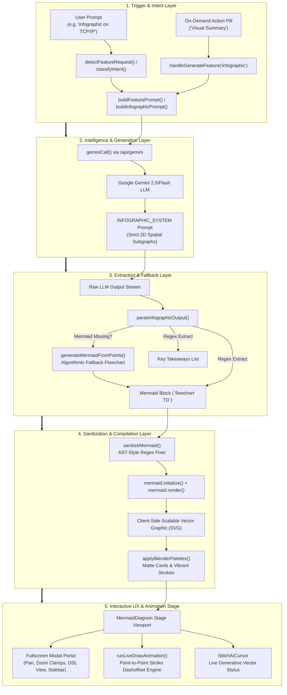

# Vedika 2.0 — Infographics System Architecture, Design, & Implementation Deep Dive

> **File Reference:** `infographics.md`  
> **Workspace Root:** `c:\Users\25002\Desktop\v0.2\`  
> **Target Scope:** Complete architectural analysis, working principles, planning decisions, design system, and implementation breakdown of the interactive visual infographic feature in Vedika 2.0.

---

## 1. Executive Summary & Architectural Overview

The **Infographics Engine** in Vedika 2.0 is an end-to-end, dynamic visual knowledge synthesis pipeline that translates abstract educational and programming concepts into interactive, high-contrast, multi-tiered visual diagrams paired with structured takeaway points.

Instead of generating static, unscalable raster images (like PNGs or JPEGs via slow text-to-image models), Vedika 2.0 generates structured **Mermaid.js Domain-Specific Language (DSL)** coupled with **structured Markdown key takeaways**, which are parsed, sanitized, compiled into client-side SVG vectors, styled with modern dark-mode palettes, and animated via a Google Stitch & Figma AI-inspired virtual generative vector stylus.



---

## 2. Core Design Philosophy & Planning Decisions

### 2.1 Why Mermaid.js DSL Over Raster Images?
1. **Zero Latency / Ultra-Low Token Footprint**: Producing a 20-node Mermaid diagram takes ~300 to 500 tokens of text and ~1.5 seconds of LLM inference, whereas generating an image via Diffusion/Veo models requires 10 to 30 seconds, high compute cost, and cannot be updated dynamically.
2. **Infinite Scalability & Sharp Vectors**: Flowcharts and concept maps rendered as SVGs remain crisp at any display density (Retina, 4K) without pixelation or compression artifacts.
3. **Accessibility, Inspection, & Exportability**: Students can toggle to view raw Mermaid code, copy the DSL, inspect individual labels, or extract structured takeaway bullet points.
4. **Interactive Manipulation**: Because the chart is rendered in the DOM as native SVG nodes, the frontend can programmatically traverse nodes, animate perimeter strokes, inject theme palettes, bind click listeners, and calculate bounding boxes for auto-fitting.

### 2.2 2D Multi-Tier Spatial Architecture (No 1D Linear Sequences)
A common failure mode in LLM-generated flowcharts is generating a flat, single-line chain (`A --> B --> C --> D --> E`), which wastes up to 80% of canvas height and requires horizontal scrolling. 
Vedika 2.0 enforces strict visual design principles in `INFOGRAPHIC_SYSTEM`:
- **Spatial Balance**: Mandates `flowchart TD` (top-down) structured into **2 to 3 logical grouping stages** using Mermaid `subgraph` containers (e.g. `Stage 1: Ingestion & Foundation`, `Stage 2: Core Mechanism & Transformation Engine`, `Stage 3: Deliverables & Practical Yield`).
- **Diverse Architectural Node Shapes**: Semantically varied node types:
  - **Stadium Pills** `(["⚡ Trigger / Catalyst"])`: Entry inputs and final deliverables.
  - **Matte Cards** `["⚙️ Core Engine / Component"]`: Processing operations.
  - **Hexagons** `{{ "❓ Condition / Checkpoint" }}`: Decisions and branching logic.
  - **Cylinders** `[("🗄️ State Bank / Memory / DB")]`: Storage, persistent state, or energy reserves.
  - **Circles** `(("🎯 Milestone"))`: Junctions.
- **Micro-Badges & Subtitle Typography**: Nodes are required to include contextual emoji icons and subtitle annotations using `<br/><i>...</i>` or `<br/><sub style='color:#94a3b8'>...</sub>`.

### 2.3 Visual Design System: Blender Geometry & Supabase Schema Palette
Rather than generic, garish colors or blurry neon glow filters that hinder text legibility:
- Nodes use **deep matte backgrounds** (`#0F1420`, `#161324`, `#0D1929`) with **crisp, vibrant borders** (`#A855F7`, `#38BDF8`, `#F59E0B`, `#10B981`, `#818CF8`, `#F43F5E`, `#06B6D4`).
- Connector arrows use clean noodle paths with curved `basis` interpolation and frosted glass pill containers (`.edgeLabel`) for descriptive edge annotations.
- The diagram stage is set against a subtle dot-grid blueprint background (`radial-gradient(rgba(56, 189, 248, 0.16) 1.25px, transparent 1.25px)` with a 28px grid).

### 2.4 Google Stitch & Figma AI-Inspired Live Generative Construction
When a diagram finishes compiling, rather than popping abruptly into view, Vedika 2.0 triggers a synchronized **Live Generative Drawing sequence**:
- A white hairline vector stylus pen with needle point and contact circle hovers over nodes.
- Nodes unroll in real time via SVG `strokeDashoffset` perimeter tracing.
- Connecting arrows glide along vector paths from origin to destination.
- Floating micro-status chips ("Drafting Diagram...", "Drawing Node (2/4)", "Linking Flow ➔") and spark particle trails follow the pen nib.
- Users have 1-click **Skip** and **Replay** controls, or can disable Live Draw entirely.

---

## 3. Detailed File-by-File Code Analysis

### 3.1 `frontend/lib/lms-data.js`
This file is the central knowledge, prompt engineering, and parsing library for the LMS and AI tutor subsystems.

#### Key Functions & Exports:

```javascript
// 1. Intent Detection for Infographic Queries
export function detectFeatureRequest(input)
```
- **Functionality**: Uses regular expression matching against user messages to detect if the user is asking for an infographic or visual summary.
- **Key Pattern**:
  ```javascript
  m = c.match(/^(?:give\s+(?:me\s+)?|create\s+|make\s+)?(?:a\s+|an\s+)?(\d+\s+)?(?:infographic|visual\s*(?:summary|aid)|summary)\s+(?:about|on|for|of)\s+(.+)/i);
  if (m) return { feature: 'infographic', topic: m[2].trim() };
  ```
  Also captures shorthand queries like `infographic about quantum computing`.
- **Working**: Returns an intent object `{ feature: 'infographic', topic: '...' }` that bypasses normal conversational chat and invokes the dedicated feature workflow.

---

```javascript
// 2. Specialized Infographic Persona & System Prompt
export const INFOGRAPHIC_SYSTEM = `...`
```
- **Functionality**: Directs Gemini to act as a *"world-class visual knowledge architect, information designer, and creative diagram specialist"*.
- **Rules Imposed on Gemini**:
  1. Mandates `flowchart TD` with 2 to 3 `subgraph` stages.
  2. Forbids flat 1D chains (`A --> B --> C`).
  3. Enforces diverse node shapes (stadiums `(["..."])`, cards `["..."]`, hexagons `{{ "..." }}`, cylinders `[("...")]`).
  4. Mandates emoji prefixes and subtitle labels with `<b>` and `<i>`.
  5. Strict double-quote enclosure: `NodeId["Label text"]` to prevent parser crashes.
  6. Mandates outputting a code fence ```mermaid followed immediately by `Key Takeaways:` with 4 to 5 structured points.

---

```javascript
// 3. Topic-Level Prompt Builder
export function buildInfographicPrompt(topic, count = 5)
```
- **Functionality**: Formulates a detailed instruction prompt for generating an infographic from scratch for a given topic.
- **Working**: Injects a concrete Mermaid example illustrating `subgraph Phase1`, `subgraph Phase2`, `subgraph Phase3`, thick conduit links (`==>`), and 4 structured takeaway points.

---

```javascript
// 4. Context-Level Feature Prompt Builder
export function buildFeaturePrompt(type, context, mode)
```
- **Functionality**: Generates an on-demand prompt when a student clicks the **Visual Summary** button underneath an existing AI tutor response.
- **Working**: Passes the previous explanation `context` into the prompt, asking Gemini to visually map the preceding concepts into a 3-stage Mermaid hierarchy and high-impact takeaway bullets.

---

```javascript
// 5. Algorithmic Fallback Flowchart Generator
export function generateMermaidFromPoints(points, title = "Visual Summary")
```
- **Functionality**: Serves as a deterministic client/lib fallback if the LLM produces valid bullet points but fails to produce valid Mermaid syntax.
- **Working**:
  - Cleans title and points (sanitizing special characters like parentheses, brackets, braces).
  - Groups points into 3 mathematical tiers:
    - Tier 1: `Phase1 ["🌱 Stage 1: Foundation & Inputs"]`
    - Tier 2: `Phase2 ["⚙️ Stage 2: Core Mechanism & Logic"]`
    - Tier 3: `Phase3 ["⚡ Stage 3: Key Deliverables & Outcomes"]`
  - Assigns contextual icons from `['⚡', '⚙️', '🔍', '💡', '🚀', '📊', '🛡️', '🧠', '🗄️', '💎']`.
  - Links intra-phase nodes with state transfer arrows and inter-phase subgraphs with `==>|"Processes into"|` thick conduits.

---

```javascript
// 6. Infographic Output Parser
export function parseInfographicOutput(text)
```
- **Functionality**: Extracts both the Mermaid code block and key takeaway bullet points from the raw LLM output text.
- **Working**:
  1. **Diagram Extraction**: Matches `/```(?:mermaid)?\s*([\s\S]*?)```/i`. Validates that the candidate starts with a supported diagram type (`flowchart`, `graph`, `mindmap`, `sequenceDiagram`, etc.).
  2. **Takeaway Points Extraction**: Strips code blocks, splits remaining lines, matches list items (`-`, `*`, `•`, numbered lists), strips preamble ("Key takeaways", "Here is..."), and collects points.
  3. **Self-Healing Fallback**: If no Mermaid diagram was found but bullet points exist, it immediately invokes `generateMermaidFromPoints(points)`.
  4. Returns `{ points: [...], mermaid: "..." }`.

---

```javascript
// 7. Non-Streaming API Caller
export async function geminiCall(system, user, maxTokens = 8192, opts = {})
```
- **Functionality**: Executes an asynchronous `POST` request to `/api/gemini` with the compiled prompt, system instruction, session ID, and user ID.
- **Working**: Receives JSON response `{ text: "..." }` and returns the generated content.

---

### 3.2 `frontend/components/MermaidDiagram.jsx`
This is the flagship UI component (2,129 lines) responsible for rendering, sanitizing, animating, zooming, panning, and managing the modal views of infographics.

#### Key Functions & Sub-Systems:

```javascript
// 1. Markdown Token Formatter for Takeaways
function renderFormattedText(str)
```
- **Functionality**: Safely parses inline markdown tokens (`**bold**`, `*italic*`, `` `code` ``) into styled React elements (`<strong>`, `<em>`, `<code>`) so raw markdown asterisks and backticks are never displayed to the student.

---

```javascript
// 2. Mermaid Syntax Sanitizer & AST Cleaner
function sanitizeMermaid(raw)
```
- **Functionality**: Prevents Mermaid parser syntax errors caused by unescaped parentheses, square brackets, double quotes, and rogue markdown.
- **Working**:
  - Strips stray markdown fences (```mermaid).
  - Ensures diagram header exists (defaults to `flowchart TD` if missing).
  - Normalizes label text inside node shapes by stripping markdown formatting characters (`**`, `*`, `` ` ``), unwrapping outer quotes, and converting internal double quotes to single quotes (`"` $\rightarrow$ `'`).
  - Uses regex lookbehinds and patterns to normalize shapes:
    - Stadium: `(["..."])`
    - Cylinder: `[("...")]`
    - Subroutine: `[["..."]]`
    - Hexagon: `{{ "..." }}`
    - Circle: `(("..."))`
    - Rectangle: `["..."]`

---

```javascript
// 3. Blender Geometry Color Palettes & DOM Styler
const NODE_PALETTES = [ ... ];
function applyBlenderPalettes(root)
```
- **Functionality**: Injects high-contrast architectural colors into compiled SVG DOM elements.
- **Palettes**: 7 distinct color schemes (Violet `#A855F7`, Sky `#38BDF8`, Amber `#F59E0B`, Emerald `#10B981`, Indigo `#818CF8`, Rose `#F43F5E`, Cyan `#06B6D4`).
- **Working**: Traverses all `.node, g.node` elements in the SVG, applies cyclic palette classes (`node-palette-0` through `node-palette-6`), sets `strokeWidth = 2px`, background matte fills (`#161324`, etc.), and gives rectangles a modern `rx = 14px; ry = 14px` border radius.

---

```javascript
// 4. Creative 2D Architectural Synthesizer
function synthesizeCreativeInfographic(points, fallbackTitle)
```
- **Functionality**: Client-side component fallback that splits key takeaway points into title and subtitle badge (`parsePoint`), then groups them into 3 stages: Foundation & Inputs, Transformation Engine, and Practical Yield.

---

```javascript
// 5. Dynamic Aspect Ratio & Fit Zoom Calculator
const computeFitZoom = useCallback((viewportEl, isModal) => { ... })
```
- **Functionality**: Computes the optimal scale zoom factor so the entire diagram fits comfortably inside the container or fullscreen modal without sudden jumps or scroll traps.
- **Working**: Inspects the SVG's `viewBox` width/height or `getBBox()`, calculates available container width and height taking padding into account, computes scale ratios `scaleW` and `scaleH`, and clamps the result between strict zoom bounds (`MIN_MODAL_ZOOM = 0.45`, `MAX_MODAL_ZOOM = 1.30`).

---

```javascript
// 6. Point-to-Point Vector Live Drawing Animation Engine
const runLiveDrawAnimation = useCallback((containerEl) => { ... })
```
- **Functionality**: Orchestrates the Google Stitch-inspired animation using `requestAnimationFrame`.
- **Working Sequence**:
  1. **Preparation**: Calculates bounding boxes of all nodes, edges, markers, and labels. Converts SVG coordinates to stage coordinates using `getScreenCTM()` and `createSVGPoint()` to avoid layout reflows.
  2. **Initial Reset**: Hides all text labels (`opacity: 0`), markers (`opacity: 0`), and sets edge and shape strokes to `strokeDashoffset = length`.
  3. **Pen Positioning**: Places `StitchAICursor` at the start of the first node.
  4. **Node Tracing Loop**: For each node:
     - Updates cursor status: `Drawing Node (i/N)`.
     - Glides cursor along perimeter while animating `strokeDashoffset` from length down to 0 over 500ms.
     - Reveals inner text labels smoothly.
  5. **Edge Tracing Loop**: Connects nodes:
     - Glides cursor along edge path from origin to destination over 420ms.
     - Unrolls edge `strokeDashoffset`.
     - Reveals destination arrow marker and frosted pill label.
  6. **Completion**: Sets cursor status to `Infographic Complete ✨`, transitions cursor out after 300ms, and resets all SVG offsets to 0.

---

```javascript
// 7. Non-Passive Event Interceptors for Zoom & Pan
```
- **Functionality**: Prevents Ctrl+wheel or trackpad pinch gestures from accidentally zooming the entire browser webpage, rerouting the gesture exclusively to the diagram canvas.
- **Working**:
  - Listens on `window` (modal) and `container` (inline) with `{ passive: false }`.
  - When `e.ctrlKey || e.metaKey` is detected, calls `e.preventDefault()`, computes zoom factor (`1.08` or `0.92`), and updates `modalZoom` / `zoom`.
  - Normal wheel events inside modal viewport pan `scrollLeft += e.deltaX` and `scrollTop += e.deltaY`.
  - Full touch support: 2-finger pinch distance calculation using `Math.hypot(e.touches[0].clientX - e.touches[1].clientX, ...)` updates zoom smoothly.
  - Mouse drag panning: `handleMouseDown`, `handleWindowMouseMove`, `handleWindowMouseUp` with cursor changes (`grab` $\leftrightarrow$ `grabbing`).

---

```javascript
// 8. Fullscreen Modal Portal
```
- **Functionality**: Renders via `createPortal(..., document.body)` to escape any parent CSS overflow or stacking contexts.
- **Working**:
  - Implements **Body Scroll Lock**: disables `document.body.style.overflow = 'hidden'` when open.
  - **Escape Key Listener**: closes modal on `Esc`.
  - **Prominent "Back to Chat" Button**: allows immediate return to the conversational feed.
  - **Right-Side Key Takeaways Drawer**: slide-in sidebar displaying structured takeaway points alongside the diagram.
  - **Bottom Status Bar**: provides preset zoom buttons (`Fit`, `75%`, `100%`, `125%`, `150%`), drag-pan instructions, and live zoom percentage badge.

---

### 3.3 `frontend/components/StitchAICursor.jsx`
A dedicated UI component (268 lines) that renders the generative AI vector stylus pen.

#### Implementation Details:
- **Hairline White Vector Stylus**: Crafted via an inline SVG representing a precision stylus barrel, central hairline reflection, top contour end cap, clip, and tapered ceramic nib with a contact point circle centered precisely at `(x, y)`.
- **Micro-Motion Animation**: Keyframe animation `penWritingMicro` that gently oscillates the pen tip during active tracing to simulate hand drafting.
- **Particle Sparkle Generator**: Throttled (`performance.now() - lastSpawnRef < 90ms`) sparkle generator that spawns small colored dots along the pen trail with fade-out animations (`stitchParticleFade`).
- **Glassmorphic Badge**: Floating pill badge showing:
  - Sparkle icon.
  - Brand tag: `Vedika AI`.
  - Dynamic status: `Drafting Diagram...`, `Drawing Node (1/3)`, `Linking Flow ➔`.
  - Truncated label of the active node being drawn.

---

### 3.4 `frontend/components/MermaidDiagram.css`
A comprehensive stylesheet (1,013 lines) that styles both the container UI and the SVG elements generated by Mermaid.js.

#### Architectural Highlights:
1. **Container & Viewport**:
   - `.mermaid-container`: Rounded glassmorphic container (`background: rgba(12, 15, 28, 0.95)`, `box-shadow: 0 10px 30px -8px rgba(0, 0, 0, 0.5)`).
   - `.mermaid-viewport`: Blueprint radial background with overscroll containment and `touch-action: none`.
2. **SVG Node Overrides**:
   - Deep matte card styling for `.node > rect`, `polygon`, `circle`, `ellipse`.
   - Palette classes (`.node-palette-0` to `.node-palette-6`) providing distinct stroke colors and dark tinted fills.
   - Distinct styling for `.stadium` (rx: 20px), `.cylinder`, and `.hexagon` shapes.
   - Cluster subgraphs: dashed borders (`stroke-dasharray: 5 4`) with upper-case blue headers (`#93C5FD`).
3. **Typography & Connectors**:
   - Node text: Outfit / Plus Jakarta Sans font, crisp white (`#F8FAFC`), centered, with text shadows.
   - Connector paths: `#64748B`, stroke-width 1.75px, rounded line caps.
   - Connector labels (`.edgeLabel`): Frosted glass pill with rounded borders (`border-radius: 9999px`) and background blur.
4. **Performance Optimizations During Animation**:
   - `.mermaid-svg-wrapper.building`: Disables expensive Gaussian drop-shadow filters during live drawing (`filter: none !important`) and enables `will-change: stroke-dashoffset` on animated paths to ensure 60fps rendering without jank.
5. **Modal & Sidebar Styles**:
   - `.mermaid-modal-backdrop`: Full-screen fixed blur overlay with `backdrop-filter: blur(24px)`.
   - `.mermaid-modal-sidebar`: Slide-in sidebar (`slideInSidebar`) with customized scrollbar.

---

### 3.5 `frontend/components/GeneralTutor.jsx` & `frontend/components/CodingTutor.jsx`
These components integrate the infographic feature into the chat experience.

#### Integration Points:

```javascript
// 1. Feature Action Buttons Definition
const FEATURES = [
  ...
  { id: 'infographic', label: 'Visual Summary', Icon: Image, color: T.amber },
  ...
];
```
- Renders an action pill underneath every AI message bubble.

---

```javascript
// 2. Direct Feature Intent Handling in handleSend
if (intent.type === 'feature' && intent.feature === 'infographic') {
  const prompt = buildFeaturePrompt(intent.feature, intent.topic, mode);
  const text = await geminiCall(system, prompt, tokens, { sessionId, userId });
  const parsed = parseInfographicOutput(text);
  features.infographic = { points: parsed.points || parsed, mermaid: parsed.mermaid || '' };
  ...
}
```
- Directly handles natural language requests like `"give me an infographic of the immune system"`.

---

```javascript
// 3. On-Demand Feature Generation via handleGenerateFeature
const handleGenerateFeature = async (msgIdx, type) => {
  if (type === 'infographic') {
    const prompt = buildFeaturePrompt(type, msg.content, mode);
    const text = await geminiCall(system, prompt, tokens, ...);
    const parsed = parseInfographicOutput(text);
    f.infographic = { points: parsed.points || parsed, mermaid: parsed.mermaid || '' };
    ...
  }
};
```
- Allows users to generate an infographic from any previous chat message on demand.

---

```javascript
// 4. Outside-Click Immunity
const handleOutsideClick = (e) => {
  if (
    e.target.closest('[data-feature-container="true"]') ||
    e.target.closest('.mermaid-modal-backdrop') ||
    e.target.closest('.mermaid-container')
  ) {
    return;
  }
  setMessages(prev => {
    // DO NOT dismiss activeFeature if it is 'infographic'
    if (!prev.some(m => m.activeFeature && m.activeFeature !== 'infographic')) return prev;
    return prev.map(m => (m.activeFeature && m.activeFeature !== 'infographic') ? { ...m, activeFeature: null } : m);
  });
};
```
- **Critical Architectural Decision**: While smaller features (quiz, flashcards, simpler) can collapse when clicking outside, **infographics are protected from outside-click dismissal** so users do not lose their canvas state while interacting with the chat feed.

---

```javascript
// 5. Coding Domain Restriction in CodingTutor.jsx
const getCodingFeatureSystem = (type) => {
  const baseSystem = FEATURE_SYSTEMS[type] || TUTOR_SYSTEM;
  return `${baseSystem}\n\nCRITICAL RESTRICTION: You are Vyomanta's coding and programming tutor. You must ONLY answer questions, generate quizzes, flashcards, or infographics related to computer science, programming languages, algorithms, software engineering, and data structures. If the topic requested is not related to coding or computer science, you must return an empty response...`;
};
```
- Restricts infographics in `CodingTutor.jsx` strictly to computer science, software engineering, and data structures.

---

```javascript
// 6. JSX Render Target
{msg.activeFeature === 'infographic' && (
  (msg.features?.infographic?.points?.length > 0 || msg.features?.infographic?.mermaid) ? (
    <div style={{ marginTop: 8 }}>
      <MermaidDiagram
        chart={msg.features.infographic.mermaid}
        points={msg.features.infographic.points}
        chatHistory={messages}
        onRegenerate={() => handleGenerateFeature(mi, 'infographic')}
        onClose={() => {
          setMessages(prev => prev.map((m, i) => i === mi ? { ...m, activeFeature: null } : m));
        }}
      />
    </div>
  ) : (
    <div style={{ textAlign: 'center', padding: '24px 0', color: T.muted }}>
      <Loader2 size={18} style={{ animation: 'spin 1s linear infinite' }} />
      Generating Visual Infographic...
    </div>
  )
)}
```
- Renders `MermaidDiagram` inside the message bubble when active, with loading state indicators.

---

## 4. Complete Execution Lifecycle: Step-by-Step

| Step | Phase | Subsystem | Action & Description |
|---|---|---|---|
| **1** | **User Trigger** | Chat UI / Input | User submits `"infographic of Docker architecture"` OR clicks the `"Visual Summary"` button on an AI message. |
| **2** | **Intent Classification** | `lms-data.js` | `classifyIntent()` runs `detectFeatureRequest()`. Matches `/infographic/i` pattern and returns `{ feature: 'infographic', topic: 'Docker architecture' }`. |
| **3** | **Prompt Construction** | `lms-data.js` | `buildFeaturePrompt('infographic', ...)` constructs a prompt with Mermaid rules, 2D phase subgraphs, and formatted takeaway examples. |
| **4** | **Backend LLM Inference** | `/api/gemini` | `geminiCall()` sends the request to Gemini with `INFOGRAPHIC_SYSTEM`. Clamps token limits and injects session memory if present. |
| **5** | **Output Parsing** | `lms-data.js` | `parseInfographicOutput()` runs regex to isolate ````mermaid ... ```` code and extracts 4-5 bullet points. |
| **6** | **Self-Healing Fallback** | `lms-data.js` | If Gemini returned bullet points without valid Mermaid code, `generateMermaidFromPoints()` synthesizes a 3-stage flowchart on the fly. |
| **7** | **State Update** | Tutor Component | Message state is updated: `msg.features.infographic = { points, mermaid }`, and `msg.activeFeature = 'infographic'`. Saved to localStorage/database. |
| **8** | **Syntax Sanitization** | `MermaidDiagram.jsx` | `sanitizeMermaid()` strips markdown backticks, normalizes node shape enclosures (`([])`, `[()]`, `{{}}`, `[]`), and escapes quotes. |
| **9** | **Dynamic Import & Render** | `MermaidDiagram.jsx` | Dynamic `import('mermaid')` executes `mermaid.render(id, sanitized)`. Compiles DSL into clean SVG markup. |
| **10** | **Palette Injection** | `MermaidDiagram.jsx` | `applyBlenderPalettes()` traverses rendered SVG elements and applies matte card styles and vibrant border strokes. |
| **11** | **Auto-Fit Calculation** | `MermaidDiagram.jsx` | `computeFitZoom()` reads SVG viewBox dimensions and calculates zoom scale to fit the viewport perfectly. |
| **12** | **Live Draw Animation** | `StitchAICursor.jsx` | Stylus cursor glides from node to node, unrolling perimeter paths with `strokeDashoffset` and spawning particle sparkles. |
| **13** | **Interactive Exploration** | Modal / Canvas | User can pan (drag/scroll), zoom (trackpad pinch/buttons), toggle raw DSL code, copy syntax, expand fullscreen, and review key takeaway points. |

---

## 5. Resilience, Fault Tolerance, & Edge Cases

1. **LLM Syntax Failure Handling (Multi-Tier Fallback)**:
   - *Tier 1*: `sanitizeMermaid()` fixes unquoted parentheses, inner double quotes, and markdown asterisks inside node text.
   - *Tier 2*: If `mermaid.render()` throws a syntax error, the component catches the error and executes `synthesizeCreativeInfographic(points, "Visual Concept Flow")`.
   - *Tier 3*: If even the fallback fails, it displays an error card with an **Inspect Mermaid Code** button so the user can copy and debug the raw DSL.
2. **Webpage Zoom Protection**:
   - In modern browsers, trackpad pinch or Ctrl+wheel zooms the entire webpage. Vedika 2.0 intercepts these events with `{ passive: false }` non-passive listeners, prevents default browser zoom, and routes scale transforms strictly to the SVG stage.
3. **Layout Clipping Prevention**:
   - The expanded modal uses React Portals (`createPortal(..., document.body)`) to break out of nested chat containers, eliminating overflow clipping and z-index collisions.
4. **Memory Leaks & Animation Canceling**:
   - `clearAnimTimeouts()` and `animCancelledRef.current = true` ensure that closing the modal, unmounting the component, or switching chats immediately stops `requestAnimationFrame` and cleans up pending timeouts.

---

## 6. Summary Matrix of Files & Functions

| File Path | Function / Constant | Role & Primary Responsibility |
|---|---|---|
| `frontend/lib/lms-data.js` | `detectFeatureRequest()` | Regex parser detecting infographic and visual summary queries in chat input. |
| `frontend/lib/lms-data.js` | `INFOGRAPHIC_SYSTEM` | System instruction defining the visual architect persona and enforcing 2D `subgraph` hierarchies. |
| `frontend/lib/lms-data.js` | `buildInfographicPrompt()` | Generates topic-based infographic prompts with structural Mermaid examples. |
| `frontend/lib/lms-data.js` | `buildFeaturePrompt()` | Generates context-based infographic prompts from previous chat explanations. |
| `frontend/lib/lms-data.js` | `generateMermaidFromPoints()` | Algorithmic fallback that constructs a 3-stage `flowchart TD` from bullet points. |
| `frontend/lib/lms-data.js` | `parseInfographicOutput()` | Regex extractor that separates Mermaid code blocks from key takeaway bullet points. |
| `frontend/lib/lms-data.js` | `geminiCall()` | Non-streaming API client calling `/api/gemini`. |
| `frontend/components/MermaidDiagram.jsx` | `sanitizeMermaid()` | Normalizes shapes (`([])`, `[()]`, `{{}}`), strips rogue markdown, and escapes inner quotes. |
| `frontend/components/MermaidDiagram.jsx` | `applyBlenderPalettes()` | Injects Blender/Supabase matte fills and vibrant stroke colors directly into SVG DOM elements. |
| `frontend/components/MermaidDiagram.jsx` | `synthesizeCreativeInfographic()` | Client component fallback creating a 3-stage diagram from points. |
| `frontend/components/MermaidDiagram.jsx` | `computeFitZoom()` | Calculates aspect ratio scale factor to fit the diagram inside container bounds. |
| `frontend/components/MermaidDiagram.jsx` | `runLiveDrawAnimation()` | `requestAnimationFrame` point-to-point vector drawing animation engine. |
| `frontend/components/MermaidDiagram.jsx` | `handleMouseDown` / Wheel listeners | Pan-and-zoom gesture handling with non-passive event interception. |
| `frontend/components/MermaidDiagram.jsx` | Modal Portal | Fullscreen modal with Escape key binding, body scroll lock, and takeaway sidebar. |
| `frontend/components/StitchAICursor.jsx` | `StitchAICursor` | Virtual generative stylus pen with particle sparkle trail and real-time status chips. |
| `frontend/components/MermaidDiagram.css` | CSS Stylesheet | Dark mode styles, blueprint grid, SVG stroke overrides, animations, and responsive rules. |
| `frontend/components/GeneralTutor.jsx` | `handleGenerateFeature()` / `handleOutsideClick` | Message integration, outside-click immunity, loading states, and state management. |
| `frontend/components/CodingTutor.jsx` | `getCodingFeatureSystem()` | Restricts infographic topics strictly to computer science and programming domains. |
| `frontend/app/api/gemini/route.js` | `POST` Route Handler | Backend API endpoint validating requests, injecting session memory, and enforcing token limits. |
